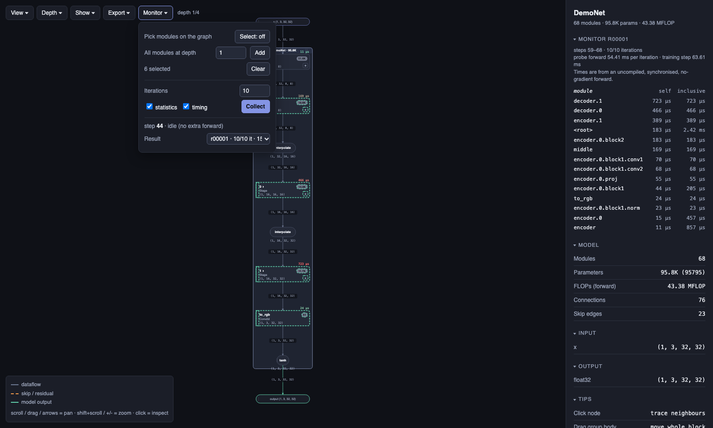

# Srivastava Book of Blocks

Neural-network building blocks in PyTorch and Flax, with two tools for looking
inside a model built from them: an interactive architecture graph, and a live
monitor for a training run.

| Package | What it is |
| --- | --- |
| [`pytorch_blocks/`](pytorch_blocks) | The blocks in PyTorch, one file per family |
| [`flax_blocks/`](flax_blocks) | The same families in Flax NNX |
| [`visualized/`](visualized) | Trace a model and write its graph as one self-contained HTML file |
| [`monitor/`](monitor) | A web page beside a training loop: statistics and timings of chosen modules, on request |

## Install

The library is used as a git submodule:

```bash
git submodule add https://github.com/RealityShifts/Srivastava-book-of-Blocks.git Blocks
git submodule update --init --recursive
pip install -r Blocks/requirements.txt
```

The examples below assume the folder is named `Blocks` and sits at the root of
your repository. Inside the library every import is relative, so another name
or location works; adjust the import paths.

`requirements.txt` covers both frameworks. For PyTorch alone you need `torch`,
plus `jaxtyping` and `beartype` for the runtime shape checks (see
[Type checks](#type-checks)); `einops` is used by a few blocks.

## The blocks

One file per architectural family, the same names in both frameworks:

| File | Contents |
| --- | --- |
| `core_blocks` | Linear, Conv, Norm, Activation, Residual |
| `attention_blocks` | Self, Cross, Causal, Sparse, Linear, RoPE |
| `transformer_blocks` | Encoder, Decoder, feed-forward variants, MoE |
| `cnn_vision_blocks` | Inception, Dense, SE, CBAM, FPN, ASPP |
| `unet_diffusion_blocks` | UNet, time embedding, CFG, ControlNet, LoRA, IP-Adapter |
| `gan_blocks` | Generator, Discriminator, AdaIN, ModulatedConv |
| `vit_blocks` | PatchEmbed, CLS, Window, ShiftedWindow, MAE |
| `sequence_blocks` | RNN, LSTM, GRU, SSM, SelectiveScan |
| `gnn_blocks` | MessagePassing, GraphConv, GAT |
| `generative_blocks` | VAE, Reparam, autoregressive, Flow, EBM, schedulers |
| `rl_blocks` | Policy, Value, ActorCritic, Replay, target network |
| `memory_retrieval_blocks` | ExternalMemory, RAG, KV cache |
| `embedding_blocks` | Token, Positional, Contrastive, ProjectionHead |
| `optimization_blocks` | Lion, Sophia, schedulers, EMA, mixed precision |
| `multimodal_blocks` | CLIP, PerceiverResampler, Q-Former |
| `efficient_blocks` | Quantization, Pruning, LowRank, parallelism |
| `specialized_blocks` | Neural ODE, FNO, KAN, Capsule, SlotAttention |
| `filters` | Anti-alias blur, alias-free activation |

```python
import torch
from Blocks.pytorch_blocks.core_blocks import ConvBlock

block = ConvBlock(3, 32, 3)
y = block(torch.randn(1, 3, 64, 64))
```

PyTorch blocks are NCHW; Flax blocks are NHWC.

### Type checks

Block `forward` methods carry `jaxtyping` shape annotations, enforced at
runtime by `beartype`. A wrong shape fails at the call with the expected and
actual shapes. Set `CHECK_TYPES=0` in the environment to turn the checks into
no-ops, for speed or for `torch.compile`.

## visualized: the architecture graph

Runs one real forward pass and writes the module graph, with shapes, parameter
counts and FLOPs, as a single HTML file. No server, no CDN.

```python
import torch
from Blocks.visualized.visualize_torch import visualize

visualize(model, torch.randn(1, 3, 224, 224), path="model.html")
```

Flax models use `Blocks.visualized.visualize.visualize` the same way. Details, the command line
and what the page shows: [visualized/README.md](visualized/README.md).

## monitor: look inside a run while it trains

```python
from Blocks.monitor import Monitor

monitor = Monitor(model, port=8891, out_dir="runs/monitor")

for step, (x, y) in enumerate(loader):
    ...                                   # your training step, untouched
    monitor.step(step, probe=lambda: model(x))
```

Open `http://127.0.0.1:8891/`, pick modules on the graph, ask for N
iterations. For those iterations the monitor runs one extra forward with hooks
on the picked modules and reports, per module, the mean, median, mode, min and
max of every input, output and parameter, and the time its forward takes.
When nothing is requested it does nothing.



Try it with `python -m Blocks.monitor.demo`. Details and limits:
[monitor/README.md](monitor/README.md).

## Checks

Each package has a smoke test that runs on CPU:

```bash
python -m Blocks.pytorch_blocks._smoke_test    # every PyTorch block, one forward
python -m Blocks.flax_blocks._smoke_test       # every Flax block (needs jax, flax)
python -m Blocks.visualized._smoke_test        # the torch tracer on a small model
python -m Blocks.monitor._smoke_test           # the monitor, 46 checks
```

## Diagrams

Architecture diagrams, one Mermaid `flowchart TD` per public block (122 across
17 categories), live in a sibling repository so the model code here stays
clean:
[RealityShifts/Srivastava-book-of-Blocks-diagrams](https://github.com/RealityShifts/Srivastava-book-of-Blocks-diagrams).
Its specs are in
[`_generate.py`](https://github.com/RealityShifts/Srivastava-book-of-Blocks-diagrams/blob/main/_generate.py);
regenerate everything with `python _generate.py`.
