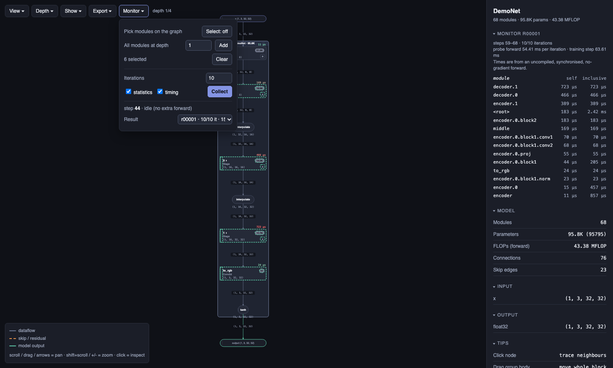
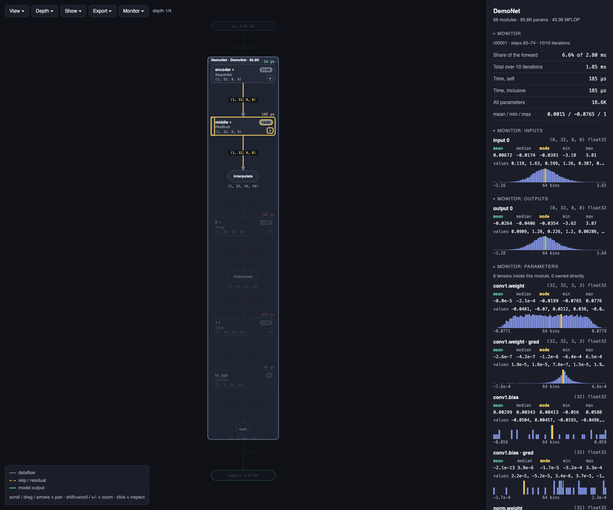
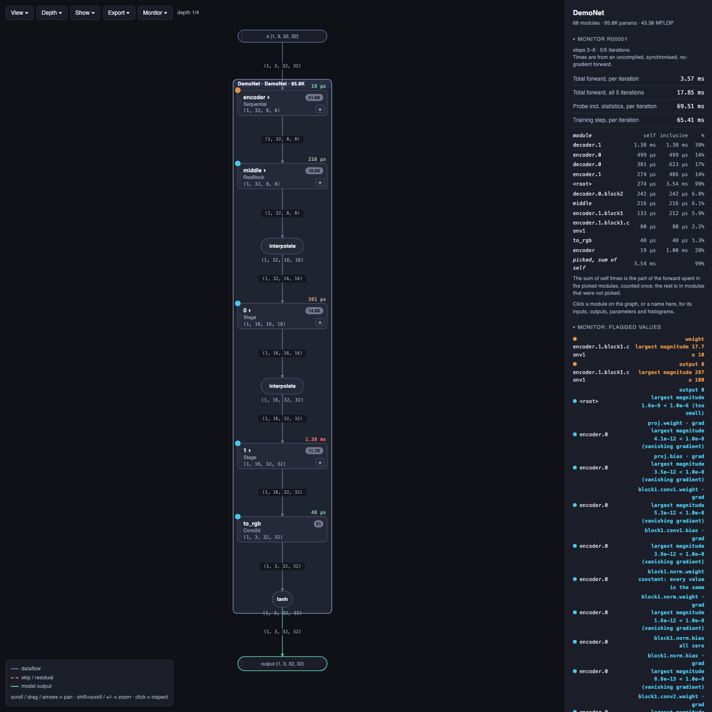

# monitor - measure chosen modules while a model trains

A small web server that sits beside a PyTorch training loop. You open a page,
pick modules on the model's graph, ask for N iterations, and get for each
picked module:

- **inputs and outputs**: mean, median, mode, min, max, shape, dtype and a
  histogram, for every tensor going in and coming out;
- **parameters**: the same for every parameter inside the module and its
  gradient, plus count, mean, min and max over all of them;
- **time**: how long its forward takes, inclusive and self.

Nothing is measured until you ask. While idle, the loop pays one attribute
check per iteration.



```
Blocks/monitor/
    server.py     Monitor: the HTTP server and the per-iteration step()
    collector.py  hooks, per-module timing, per-iteration records, summaries
    stats.py      mean / median / mode / min / max / histogram of one tensor
    page.py       the page: Blocks.visualized's graph plus the monitor controls
    demo.py       a small training loop with the monitor attached
    _smoke_test.py
```

PyTorch only. No dependencies beyond `torch` and the standard library.

## Quick start

```python
from Blocks.monitor import Monitor

monitor = Monitor(model, port=8891, out_dir="runs/monitor")

for step, (x, y) in enumerate(loader):
    loss = loss_fn(model(x), y)          # the training forward, untouched
    optimizer.zero_grad()
    loss.backward()
    optimizer.step()

    monitor.step(step, probe=lambda: model(x))
```

Open `http://127.0.0.1:8891/`.

`probe` is how the monitor gets the current inputs: a function the loop makes
each iteration that runs one forward on this iteration's batch. The server
never sees a batch. `step` calls `probe` only while a request is active.

To try it without a model of your own:

```bash
python -m Blocks.monitor.demo            # prints the address, runs until Ctrl-C
```

## From code: any input, any time

The page is one way to ask. The same things can be driven from the loop.

**One pass on an input of your own, every module:**

```python
result = monitor.measure(lambda: model(my_input))
```

`measure` runs the probe at once (it does not wait for the page or for
`step`), returns the result, and stores it, so it also shows up on the page
and can be downloaded. `paths` picks modules (default: all of them), `n` the
number of passes:

```python
result = monitor.measure(lambda: model(my_input), ["encoder", "decoder.1"], n=3)
out = result["summary"]["modules"]["encoder"]["calls"][0]["outputs"][0]
print(out["shape"], out["min"]["mean"], out["max"]["mean"])
```

**The probe is yours on every call.** `monitor.step(step, probe)` takes a new
function each iteration, so what gets measured is decided where you call it:

```python
monitor.step(step, probe=lambda: model(x))                # this batch
monitor.step(step, probe=lambda: model(fixed_input))      # always the same input
monitor.step(step, probe=lambda: model.encoder(x))        # only part of the model
```

**Queue a request from code** instead of from the page, for example every
1,000 steps:

```python
if step % 1000 == 0:
    monitor.request(["encoder", "decoder"], n=5)
monitor.step(step, probe=lambda: model(x))
```

No server is needed for any of this: `Monitor(model, start=False)` measures
and stores without serving a page.

## How a request runs

For each of the N iterations after you press **Collect**:

1. the loop's own training step runs as always - no hooks, same compiled code,
   same gradients;
2. `monitor.step` puts hooks on the picked modules, calls `probe()` once under
   `torch.no_grad()`, and takes the hooks off again;
3. that iteration's numbers are stored.

After N iterations the request closes itself, the result is written to
`out_dir` as `r00001.json`, and the page shows it. So the forward runs twice
per iteration during a request and once otherwise.

Everything that touches the model happens in the loop's thread, inside
`step`. The server thread only reads and writes the request slot.

## The page

It is the architecture graph from `Blocks.visualized` - same boxes, expand and
collapse by depth, pan, zoom and details panel - with a **Monitor** menu added.

- **Select: on**, then click boxes to pick modules, at any depth. Or add every
  module at a given depth, or **Add all**. Picked modules get a dashed green
  outline.
- Set the number of iterations, choose statistics and/or timing, **Collect**.
- With nothing selected, the details panel lists the measured modules sorted
  by self time, then the min .. max of each one's first input and output.
  Click a row to jump to that module.
- Click a module to see its tables: time, every input, every output, every
  parameter. Each tensor has mean, median, mode, min, max, a preview of its
  first values (all of them for a vector of 16 or fewer) and a histogram.
- **Parameters of everything inside** (on by default) lists every parameter
  under a picked module. A container such as a `Sequential` or a residual
  block owns no parameters itself, so with this off only leaf layers show any.
  Pick the root to see every parameter of the model; the page shows the first
  40 per module, so pick a smaller module to read the rest.
- Picking a module in Select mode also opens its details. A module called more than once per forward
  (shared weights) has one card per call, each with its own numbers.
- After a timing run each card carries its self time, coloured from green
  (cheap) to red (the most expensive measured).
- The Result list reopens any earlier request.



### Saving and downloading

Every finished request is written to `out_dir` as `r<NNNNN>.json` (when
`out_dir` is set) and stays in the Result list across restarts. From the
Monitor menu, **Download** gives the selected result as:

- **Table (CSV)**: one row per tensor and per timing, with module, class,
  call, kind (`time`, `input`, `output`, `parameter`, `gradient`), tensor
  name, shape, dtype, mean, median, mode, min, max, std, the lowest and
  highest value any iteration saw, self and inclusive time, and share of the
  forward. Opens in a spreadsheet or pandas.
- **Full (JSON)**: everything, including every iteration's numbers and
  histograms.

The same files are at `api/results/<id>.csv` and `api/results/<id>.json`, and
from code:

```python
monitor.export("r00001", "runs/monitor/r00001.csv")    # or a .json path
```

The CSV does not carry the colour flags; apply your own limits to its
`lowest` / `highest` columns.

### Colours and the legend

Every result has a **legend** section in the details panel. The `mean` and
`mode` labels above each row of numbers are green and yellow to match the
histogram. In short:

| Mark | Meaning |
| --- | --- |
| green line in a histogram | the mean |
| yellow bar in a histogram | the mode: the fullest bin |
| lavender bars | how many values fall in each bin, min on the left, max on the right |
| blue dot or text | too small: all zero, constant, a collapsed activation, a vanishing gradient |
| orange dot or text | large |
| red dot or text | dangerous (a runaway activation, an exploding gradient) or non-finite (NaN / Inf) |

A tensor is judged on its largest magnitude over the request's iterations:

| | too small (blue) | large (orange) | dangerous (red) |
| --- | --- | --- | --- |
| inputs and outputs | below 1e-6 | 100 or more | 10,000 or more |
| parameters | below 1e-8 | 10 or more | 100 or more |
| gradients | below 1e-8 | 1 or more | 100 or more |

These limits are rules of thumb, not laws. Change them for your model:

```python
Monitor(model, thresholds={"activation": {"warn": 50, "danger": 1000},
                           "gradient": {"tiny": 1e-10}})
```

Where the marks appear:

- a dot on each card of the graph whose module has a flagged tensor (a
  container is marked when anything inside it is);
- a **flagged values** list in the overview, worst first, each parameter named
  once under the innermost picked module;
- the min and max cells, the title dot and a one-line reason on each tensor's
  table.

A freshly initialised norm layer is flagged blue (its weight is constant and
its bias all zero), as is any zero-initialised layer. That is correct but not
a problem; it stops once the layer has trained.



A model with NaN in it still loads: non-finite values are counted per tensor
and left out of the statistics, and the result file is always valid JSON.

A link can open the page in a given state:
`#panel=1&sel=encoder.0,middle&depth=2&result=r00001&node=encoder.0`.

### The graph

The graph needs one traced forward pass. Give the monitor a traced graph, or a
function that returns one; a function is called once, in the loop's thread,
the first time the page is opened:

```python
from Blocks.visualized.tracer_torch import trace_model

monitor = Monitor(model, port=8891,
                  graph=lambda: trace_model(model, example_input))
```

Without `graph` the page draws the module tree (nesting, classes, parameter
counts) with no connections or shapes. Everything else works the same.

## What the numbers mean

| Number | Definition |
| --- | --- |
| mean, std, min, max | over the finite values; non-finite ones are counted separately |
| median | midpoint of the two middle values. Exact up to 1,000,000 elements; above that, taken on a fixed random sample and marked as such |
| mode | centre of the fullest of 64 equal-width histogram bins between min and max. Floating-point values rarely repeat, so the most frequent exact value would say nothing |
| total forward | wall time of the whole probe forward, with the monitor's own statistics work subtracted. Shown per iteration and summed over the N iterations |
| inclusive time | wall time of the module's forward, device synchronised at entry and exit, with the monitor's own statistics work subtracted. Also shown as a share of the total forward |
| self time | inclusive time minus the inclusive time of the *picked* modules called directly inside it. Children you did not pick stay in the parent's self time |

Each table shows the mean over the N iterations; hover a number for its range
across them. The histogram is the last iteration's.

## Limits

- **A request costs a second forward per iteration**, plus memory for one
  forward without gradients. The result reports the probe's time next to the
  training step's.
- **Timings rank modules; they are not training-step times.** They come from
  a forward that is synchronised at every picked module, runs without
  gradients, and excludes the backward pass.
- **Hooks do not fire inside compiled code.** If part of the model is
  `torch.compile`d, call the uncompiled version inside `probe`. A module that
  was not reached reports "not called".
- **Only `forward` is measured.** A module used through another method shows
  in the tree but reports nothing.
- **The probe is a real forward in the model's current mode.** Anything a
  forward changes is changed once more per iteration during a request:
  BatchNorm running statistics, random-number draws (dropout, noise), cached
  attributes. Training is not bit-identical while a request runs.
- **One process.** In a distributed run, start the monitor on one rank
  (`Monitor(..., start=False)` on the others); numbers are that rank's.
- **No login.** The server binds to `127.0.0.1` by default. Reach it through
  an SSH port forward. If you put it behind a public address, anyone with the
  link can make the run do extra forwards.

## API

```python
Monitor(model, *, port=8891, host="127.0.0.1", out_dir=None,
        graph=None, title=None, thresholds=None, start=True)
```

| Member | |
| --- | --- |
| `step(step, probe)` | call once per iteration, after the training step |
| `start()` / `stop()` | start or stop serving |
| `url`, `port` | where it is listening (`port=0` picks a free port) |
| `measure(probe, paths=None, n=1, ...)` | measure now and return the result; all modules by default |
| `request(paths, n, stats=True, timing=True, deep=True)` | queue a request for the next `n` calls of `step` |
| `export(id, path)` | write a result to a `.csv` or `.json` file |
| `status()`, `result(id)` | what the page reads |

A failing `probe` does not stop the loop: the request ends, the traceback is
printed to stderr and shown on the page.

HTTP: `GET /`, `GET /api/status`, `GET /api/tree`, `GET /api/results/<id>`
(also `<id>.csv` and `<id>.json` as downloads),
`POST /api/request` with
`{"paths": [...], "n": 10, "stats": true, "timing": true, "deep": true}`.
The page uses relative URLs, so it works behind a reverse proxy under a prefix.

`Collector` can also be used alone, without a server:

```python
from Blocks.monitor import Collector

with Collector(model, ["encoder", "encoder.0"]) as c:
    with torch.no_grad():
        model(x)
data = c.record()
```

## Checks

```bash
python -m Blocks.monitor._smoke_test
```

63 checks with known answers: statistics on constructed tensors, hooks removed
afterwards, tuple/keyword/dict inputs and outputs, a module called twice,
timing of modules with a known sleep, exactly N probe forwards per request and
none while idle, rejected requests, a failing probe, and results surviving a
restart.
